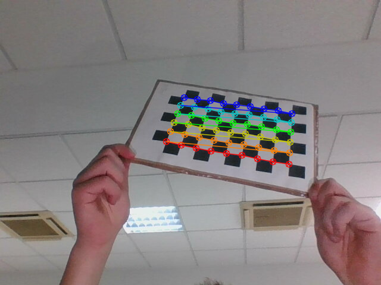

# Camera Calibration and Augmented Reality

> University team project, 2023, University of Alicante (Perception Systems).
> Republished from the team's original repository.

<!-- DEMO VIDEO: pending from owner -->



Calibrates cameras with OpenCV from chessboard and circle-grid photos, measures how reprojection error changes with the number of images, and uses the result to draw a moving 3D car over a live webcam image.

## Why it is interesting

It covers the full path from raw photos to pose estimation: intrinsics and distortion, undistortion, then PnP pose and 3D-to-2D projection in real time. The team compared two webcams and an iPhone 11, as well as three calibration patterns.

## Stack

Python, OpenCV, NumPy. `errors_graph.ods` holds the analysis. Printable targets are from calib.io.

## How it works

```
photos ─► find corners / circles ─► cv2.calibrateCamera ─► Matrix/matrix_CxR.npz
                                           │                        │
                     undistorted images ◄──┤                        ▼
                     reprojection error ◄──┘    webcam frame ─► solvePnPRansac
                                                                    │
                                     car point cloud ─► projectPoints ─► drawn frame
```

- `chess_calibration.py`: chessboard calibration with sub-pixel corner refinement; saves undistorted images, corner drawings and the matrix.
- `circles_calibration.py`: the same flow with `findCirclesGrid` on an 11x8 grid.
- `csv_export_calibration.py`: re-calibrates with a growing number of images (step 3) and writes the error to `error_2.csv`.
- `car_drawing.py`: loads `Matrix/matrix_9x6.npz`, finds the board in each webcam frame, estimates its pose and draws a car. A 50-step offset makes the car move along the board.

## Results

All values come from `errors_graph.ods` and `Matrix/`.

Mean reprojection error by number of images:

| Images | Webcam 1 | Webcam 2 | iPhone 11 |
|---|---|---|---|
| 1 | 0.0120 | 0.0075 | 0.249 |
| 10 | 0.0117 | 0.0102 | 0.408 |
| 16 | 0.0137 | 0.0106 | 0.408 |
| 25 | 0.0141 | 0.0107 | – |
| 40 | 0.0137 | 0.0109 | – |

Dividing by the focal value the script computes (926.4, 906.3 and 4068.4), the iPhone 11 error at 16 images is still about 7 to 9 times the webcam error.

Intrinsics stored for each pattern, in pixels:

| Pattern | fx | fy | cx | cy |
|---|---|---|---|---|
| 9x6 | 640.68 | 641.20 | 313.86 | 238.00 |
| 11x7 | 640.08 | 640.74 | 312.97 | 237.18 |
| 11x8 | 641.20 | 642.17 | 312.93 | 237.45 |

### How to read these numbers

- The error is `cv2.norm(L2) / number of points`, averaged over images. It is lower than the usual per-point RMS, so it should not be compared with published RMS figures.
- It is measured on the same images used for calibration, with no held-out set.
- `csv_export_calibration.py` does not clear its point lists between steps, so each step also includes the points of earlier steps.
- The focal value is `sqrt(fx² + fy²)`.
- The files do not record which batch produced each spreadsheet series, or which camera produced each matrix.

## How to run

These steps come from the files in the repository; they were not re-run for this publication. Run everything from the repository root, with a display available.

```
pip install opencv-python numpy
python car_drawing.py            # needs a webcam and a printed 9x6 chessboard; press Shift+E to quit
python circles_calibration.py    # runs as is on Lote_6_Batch
```

`chess_calibration.py` and `csv_export_calibration.py` point at batches that are not included here. Before running them, set this line at the top of each file:

```python
LOTE = 'Lote_3_25images/'
```

The included iPhone photos are examples only: the scripts look for `*.jpg`, and they use the 640x480 webcam resolution by default.

## Repository layout

```
*.py                  Calibration and drawing scripts
Matrix/               Saved intrinsics and distortion for each pattern
errors_graph.ods      Error analysis
Circulos_11x8.pdf     Printable circle target (calib.io)
Cuadrados_11x7.pdf    Printable chessboard target (calib.io)
Images/Not_Calib/     Input photos
Images/Calib/         Sample undistorted output
Images/Drawing/       Sample corner drawings
```

The image set is a small subset of the original. Photographs showing people were left out, so the results above cannot be fully reproduced from this repository.

## Team and credits

Commit authors: [alejandrorubioo](https://github.com/alejandrorubioo), alexmolera.

Team project; I worked across the whole implementation.

All rights remain with the authors; a licence is pending.
